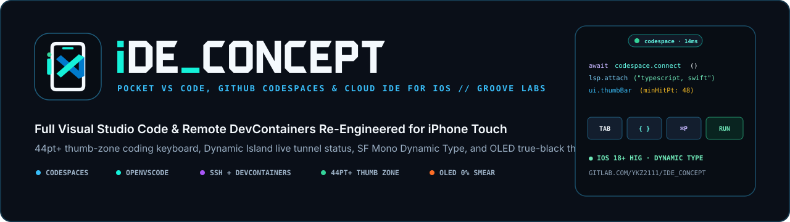

<div align="center">
  <picture>
    <source media="(prefers-color-scheme: dark)" srcset="./brand/repo-banner-dark.svg" />
    <source media="(prefers-color-scheme: light)" srcset="./brand/repo-banner-light.svg" />
    
  </picture>

  <br />

  
  
  
  
</div>

---

# iDE (`iVisualStudio`)

**Visual Studio Code, GitHub Codespaces, OpenVSCode Server, JetBrains Gateway & SSH DevContainers — re-engineered for one-handed iOS touch.**

Built under **Groove Labs // YkZ21**. One repository, one `iVisualStudio` remote, pushed to two hosts:

- GitLab: https://gitlab.com/groove-labz/iVisual-Studio
- GitHub: https://github.com/ykz2111/iVisualStudio

---

## Interactive Playground & Brand Studio

Open **[`./ide-mobile-studio.html`](./ide-mobile-studio.html)** in any browser to:
1. **Play with the Live iPhone 16 Pro Pocket VS Code Simulator**:
   - Tap the **Dynamic Island Tunnel Pill** (`codespace-main · 14ms`) to switch live between GitHub Codespaces, OpenVSCode Server, SSH DevContainers, and JetBrains Gateway.
   - Tap the **48pt Ergonomic Thumb-Zone Coding Bar** (`{ }`, `=>`, `⌘P`, `RUN ▶`, `lpBOT`, `3000`, `GIT`, `SSH`) to insert snippets, open the iOS Bottom-Sheet Command Palette, run builds in the pull-up terminal sheet, or invoke `lpBOT` AI refactoring.
   - Toggle the **Fitts' Law Thumb-Zone Heatmap (`H`)** and test **OLED True-Black (`#000000`)**, **Machined Obsidian (`#05080E`)**, **VS Code Dark+**, and **Outdoor Sunlight High-Contrast** themes.
2. **Customize & Export the `iDE` & `lpBOT` Icon Suite**:
   - Switch between 4 structural icon variants (`01 Pocket Code Ribbon`, `02 Mobile Coder lpBOT`, `03 iDE Geometric Prism`, `04 Cloud DevContainer Pod`), tweak colors/tilt/squircle radius, inspect the `16×16` 8× pixel loupe, and export SVGs or PNGs (`1024px`, `512px`, `180px`, `1200×630` OG, `1280×360` Repo Banner).

---

## Native iOS app (`./ios/`)

A SwiftUI shell with a native editor — built against `docs/IOS-PORT-PLAN.md`
(phases 1–3 shipped, 4–6 partial) and `docs/DESIGN-PLAN.md`.

```sh
open ios/iDE.xcodeproj    # Xcode 26+, iOS 18+
```

| Surface | What it does |
|---|---|
| Workspaces | Sample, imported folders (security-scoped bookmarks), GitHub clones, SSH hosts — all persisted across relaunch |
| Editor | Native `UITextView` editing, line numbers, indent engine, find & replace with regex, autosave with a 0.9 s debounce |
| Thumb bar | 48 pt cursor cluster, brackets, symbols page, undo/redo, above the keyboard |
| Git | Changes → unified diff (glyph + rule, never colour alone) → commit, pushed through GitHub's blobs → tree → commit → ref API |
| SSH | `swift-nio-ssh`, pinned host keys, mirrored tree with per-file push-back, terminal sheet, task runner, port list |
| Diagnostics | Minimal LSP client over the session (completion, definition, publishDiagnostics) |
| lpBOT | Selection-scoped assist against a model endpoint you name; off until configured |
| Connections | The signature pill: host · protocol · live round trip, text only, no pulsing |

Credentials live in the Keychain. No code executes on device by design (build
plan §5); the webview runs remote VS Code only behind the Advanced toggle.

---

## Mobile UX & UI Design System (`@mobile-design` + `@ui-design-system`)

| Principle | Desktop VS Code Problem on Phone | `iDE` iOS Solution |
|---|---|---|
| **Fitts' Law & Thumb Zone** | Menu bar, file tabs, and activity bar sit in the top-left stretch zone with `<28px` targets. | **48pt × 46pt (`≥8pt` gap) Thumb-Zone Coding Bar** + pull-up **Terminal & `⌘P` Bottom Sheets** in the bottom 35% arc. |
| **OLED Battery & Outdoor Legibility** | Washed-out gray themes drain OLED power and fail in sunlight. | **OLED True-Black (`#000000`)** & **Machined Obsidian (`#05080E`)** surfaces + **WCAG AAA (`>11:1`)** syntax tokens and an outdoor sunlight mode. |
| **iOS HIG & Safe Areas** | Web wrappers clip under the Dynamic Island and Home Indicator. | **Dynamic Island** becomes the live SSH/Codespace latency pill; **SF Pro / SF Mono Dynamic Type** (`11pt`–`34pt`) + native haptic feedback (`.light`, `.medium`, `.success`). |

---

## Complete Brand, Xcode & Workspace Asset Pack (`./brand/`)

See [`./brand/README.md`](./brand/README.md) for the full inventory:
- **Xcode `AppIcon.appiconset`**: `./brand/ios/AppIcon.appiconset/` (`1024`, `180`, `167`, `152`, `120`, `87`, `80`, `60`, `58`, `40` opaque 24-bit RGB PNGs + `Contents.json`).
- **Master & Micro Vectors**: `ide-icon.svg`, `ide-icon-micro.svg`, `ide-icon-mono.svg`, `ide-wordmark-{dark,light,compact}.svg`.
- **Announcements & Social**: `og-image.png` (`1200×630`), `social-announcement-square.png` (`1080×1080`), `repo-banner.png` (`1280×360`).
- **Workspace & iPhone OLED Wallpapers**: `backgrounds/ide-workspace-bg-4k.png` (`3840×2160`), `ide-workspace-bg-fhd.png` (`1920×1080`), and `ide-ios-wallpaper.png` (`1179×2556`).
- **Design Tokens**: `brand/tokens.css` & `brand/design-tokens.json` (W3C DTCG format).

---

## Current Implementation Status (Source Review)

This section describes what is present in `ios/iDE/` now, rather than treating the plans or browser playgrounds as proof that a feature ships in the native app. The native target is a SwiftUI iOS application (`iDE`), configured for iOS 18 and iPhone/iPad. The project is currently version 1.0 (build 1), uses Swift 5 mode, and has one application target. Its remote Swift packages are SwiftNIO, swift-nio-ssh, and swift-crypto.

### Implemented native app

- **Workspace library:** bundled sample project, imported local folders using security-scoped bookmarks, GitHub repository workspaces, and SSH workspaces. The library and remote workspace files are stored under Application Support; local folder edits write back to the imported folder.
- **Code editor:** native `UITextView` wrapped for SwiftUI, with line-number gutter, basic regex-based syntax colouring, cursor movement, indentation/newline helpers, undo/redo, find and replace (including regex), configurable code size, and a 48 pt coding bar. Edits autosave after a 0.9 second debounce. Sample workspace edits last only for the current app process; imported local files are written to their folder; GitHub and SSH edits are made in a local mirror until explicitly synced or committed.
- **GitHub transport:** a personal access token is stored in Keychain. The app can list repositories, clone a selected repository/branch, pull text-file changes, show unified diffs, and commit/push selected changes using GitHub's REST Git Data API. Branch updates are non-forced; a rejected update asks the user to pull and retry. The current Connect screen also offers clipboard token paste and a repository picker.
- **SSH transport:** SwiftNIO SSH supports password authentication and unencrypted OpenSSH Ed25519 private keys. On first contact, the app shows the SHA-256 host-key fingerprint and asks the user to verify it before sending credentials; later key changes require explicit re-trust. Workspace files are mirrored through remote shell commands and base64; SSH Git status is read-only, while local changes are sent only by an explicit sync or commit action.
- **Remote terminal and tasks:** a native sheet streams output from remote `exec` commands, reads named tasks from `.ide/tasks.json` or `.vscode/tasks.json`, and keeps a capped transcript. This is not a full interactive terminal emulator or PTY. The ports sheet parses listening sockets and offers a URL to copy/open; it does not implement a port-forwarding tunnel.
- **Language assistance:** a small Language Server Protocol client can start a configured server over SSH and handle initialization, document-open, completion, definition responses, and published diagnostics. Completions and diagnostics are presented in a sheet. During this review, the editor opens a document with the LSP but does not send subsequent edits to it, so server results may become stale; definition handling is implemented in the client but is not exposed as an editor action.
- **Selection-scoped AI:** lpBOT can call a manually configured OpenAI-compatible endpoint/model and optional Keychain-held key. It sends only the selected text plus the instruction, and the user applies the proposed replacement. No endpoint or model is bundled, so this feature is inactive until configured.
- **Web IDE access:** the Connect sheet opens GitHub Codespaces for a chosen repository/branch (or the account's Codespaces list) and GitLab Web IDE for a pasted project URL or namespace path. These explicit launches use the provider's browser session in `WKWebView`; custom remote URLs remain configurable in Settings. This adds no native Codespaces tunnel or GitLab API provider.
- **App setup and privacy:** a three-page onboarding flow, settings for haptics/editor size/advanced web/LSP/AI configuration, credential erasure, and a privacy manifest are present. The app is dark-mode-only in the current Xcode build settings.

### Current boundaries and important constraints

- GitHub authentication for REST Git is by manually supplied personal access token; OAuth device flow and a native Codespaces tunnel/provider are not implemented. Codespaces links open the browser-based experience only. GitLab Web IDE uses its own browser session; there is no GitLab API or native workspace provider.
- GitHub and SSH workspaces mirror text, not a complete repository/filesystem. GitHub clone/pull skips symlinks and blobs over 400 KB and only keeps readable UTF-8 text. SSH discovery is capped at 2,500 files under 400 KB and filters to recognized text paths. The local browser and Quick Open also cap enumeration.
- SSH push-back uses remote shell commands rather than SFTP. The terminal is command-at-a-time remote execution, not a persistent shell with full terminal control sequences. Ports are discovered, not forwarded.
- The local-folder workspace path does not expose Git actions in the app; Git UI is available for GitHub and SSH workspaces.
- Syntax colouring is a lightweight token/regex pass, not Tree-sitter or a language-aware parser. The editor is not Runestone-based.
- No automated test source files or XCTest target are present in the project tree/project configuration reviewed. The simulator build succeeded during this review; no simulator interaction or live provider sign-in was exercised.

### Repository state and source of truth

The HTML files `ide-mobile-studio.html` and `ide-mobile-studio-v2.html` are interactive design/playground prototypes; they are separate from the native SwiftUI implementation. `docs/IOS-PORT-PLAN.md` and `docs/DESIGN-PLAN.md` describe intended scope and acceptance gates, so planned items should not be read as implemented unless listed above.

For implementation details, see [`docs/IOS-PORT-PLAN.md`](./docs/IOS-PORT-PLAN.md), [`docs/DESIGN-PLAN.md`](./docs/DESIGN-PLAN.md), and the [`ios/iDE/`](./ios/iDE/) source directory.
